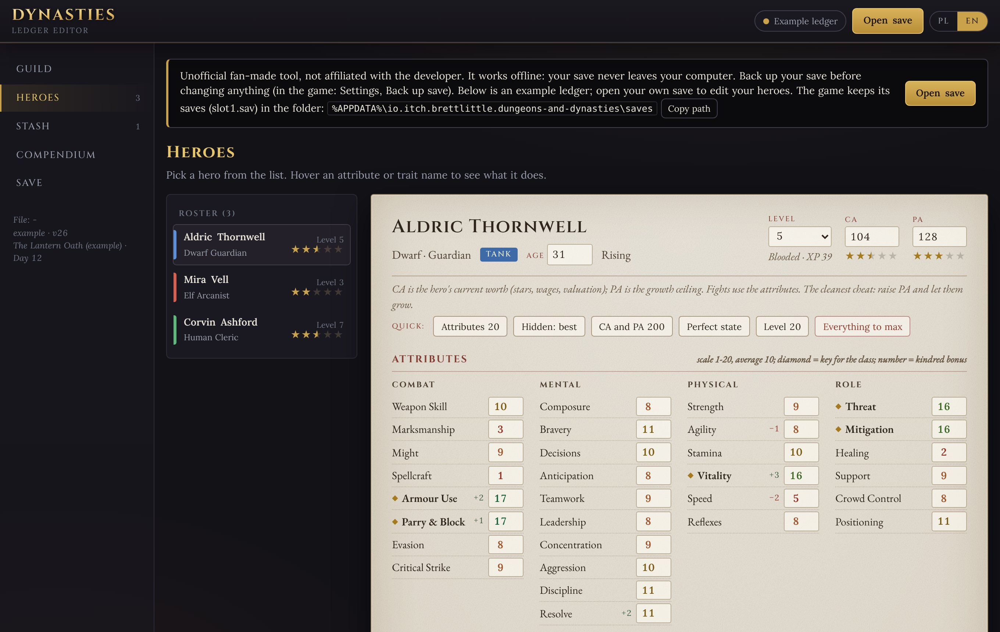
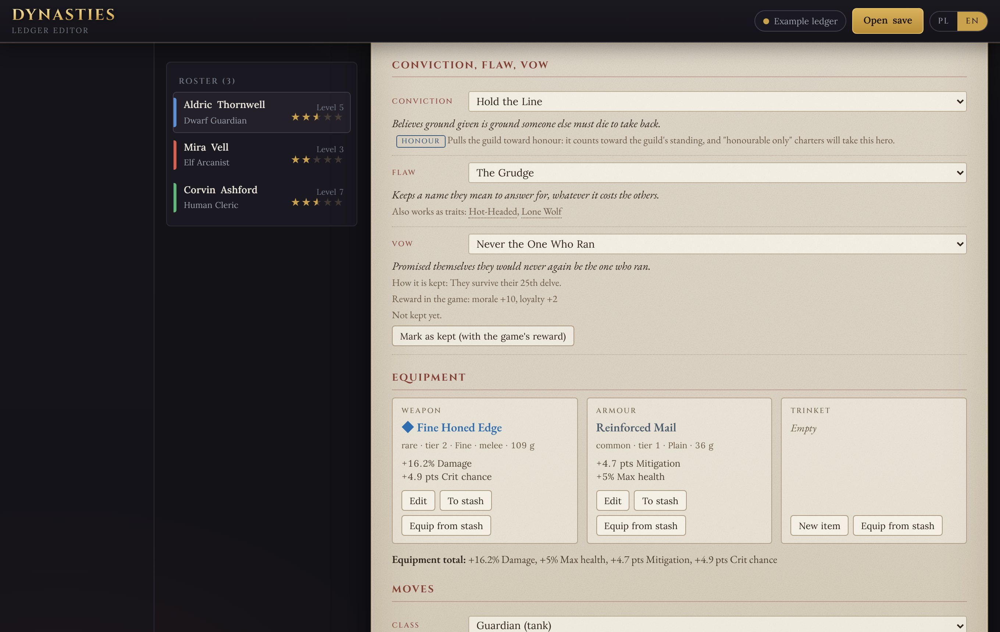
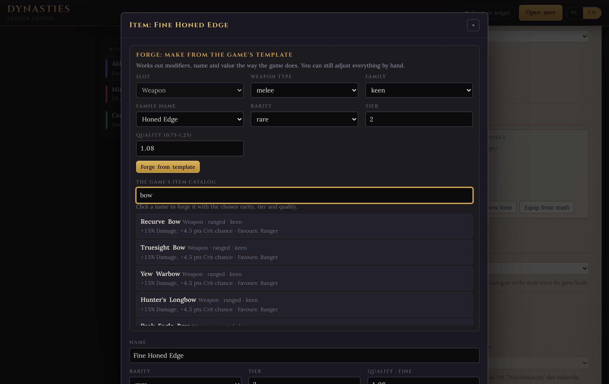

# Dynasties Ledger Editor

An unofficial, offline save editor and compendium for **Dungeons & Dynasties**.

> Fan-made tool, not affiliated with or endorsed by the game's developer or publisher.
> Always back up your save before editing.

**Open it:** https://miksonus.github.io/dynasties-ledger-editor/

Or download [`index.html`](index.html) (Download raw file) and open it in any modern browser (Chrome, Edge, Firefox). Nothing to install, and it works without an internet connection.

Shared with the developer's permission.

## What it does

- **Heroes** (roster and tavern recruits): name, age, level, CA and PA, all 30 attributes and 7 hidden attributes, morale, condition, stress, fatigue, contract years and wage, injuries.
- **Traits**: add or remove traits from a searchable list with every trait's description. Clashing traits (for example Brave and Cowardly) are handled the way the game handles them.
- **Conviction, flaw and vow**: pick any of the game's 55 convictions, 54 flaws and 75 vows. Each one comes with its description, how a vow is kept, and its reward. You can also mark a vow as kept, with the game's reward.
- **Moves**: class (and with it the signature move and second calling), and the Grizzled choice: deeper move, second calling or gift.
- **Items**: edit everything about an item, or forge one from the game's own templates with the game's formulas. There is a searchable catalog of every item the game can drop, and you can move items between heroes and the stash.
- **Guild**: name, gold, renown, plus quick actions for the whole roster.
- **Quick max buttons** that stay within the values the game accepts (attributes 20, CA and PA 200, and so on).
- **Compendium**: attributes, classes, kindreds, all traits, convictions, flaws and vows, synergies, items and modifiers, growth and career rules, and a table of every limit.
- **Hover help** on almost every value, in **English and Polish** (switch at the top right).

## How to use it

1. In the game: **Settings, Back up save** (or copy the save file somewhere safe).
2. Click **Open save** and pick `slot1.sav` from
   `%APPDATA%\io.itch.brettlittle.dungeons-and-dynasties\saves`
   (paste that path into the address bar of the file dialog).
3. Make your changes.
4. Go to **Save** and choose one of these:
   - **Recommended:** download the backup `.json`, then in the game use **Settings, Restore...** and pick that file. The title screen option **Load a Ledger, From a backup file** works too.
   - **Or:** download the `.sav`, close the game, and put the file in the save folder in place of the old one.

The editor recomputes the save's signature, so the game does not mark the save as changed outside the game.

## Good to know

- Everything happens in your browser. Your save is never uploaded anywhere.
- Demo saves are refused: the editor works with the full game only.
- Built from the game as of November 2026 (save version 26). A game update may change things.
- On load the game moves a weapon that does not suit the hero's class to the stash, and puts a beast's kind trait back. The editor warns about both.
- Editing a save can affect achievements and the game's balance. Use at your own risk.

## Credits and licences

- Game names, descriptions and data belong to the game's developer and publisher. They are shown here only to describe the game.
- Embedded fonts: Cinzel, EB Garamond and Lora, under the SIL Open Font License 1.1. The full notice is at the top of `index.html`.
